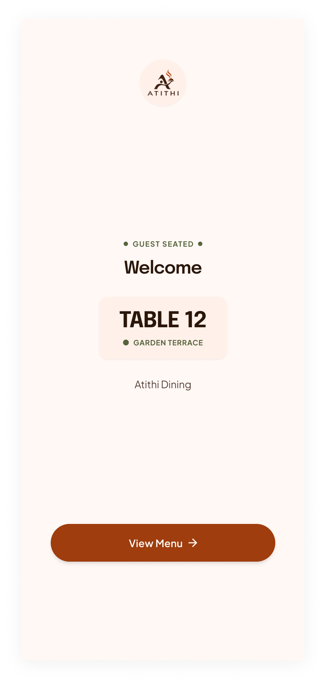
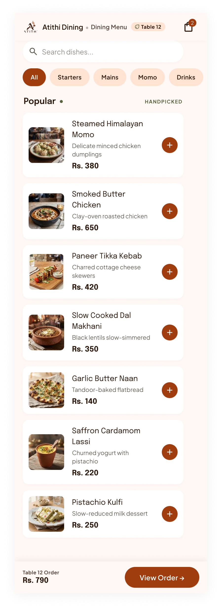
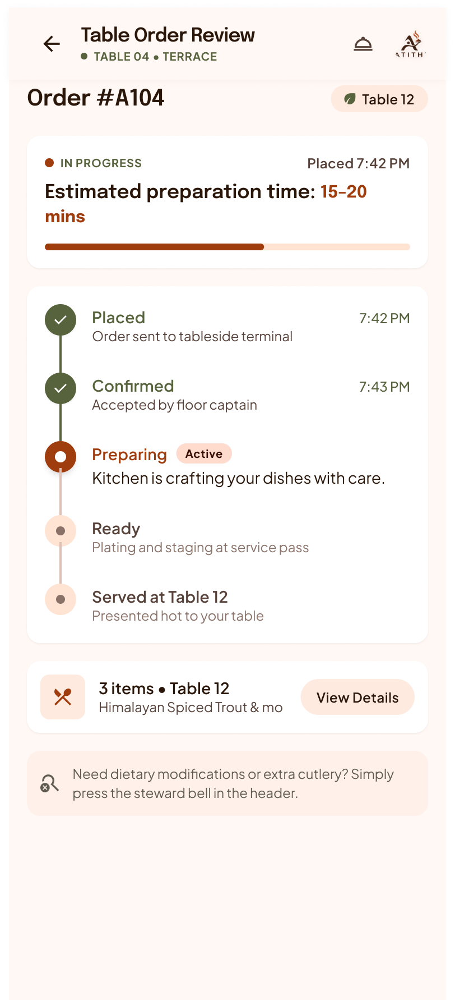

# ATITHI — Guest-First Restaurant Ordering & Dining Experience

  

  <strong>A better dining experience starts with the guest.</strong>

---

## Project Overview

**ATITHI** is a guest-first digital restaurant ordering and dining platform designed to make the restaurant experience simpler, clearer, and more convenient.

The platform allows restaurant guests to scan a QR code at their table, explore the digital menu, customize food items, review their orders, make payments, and track order status through a unified interface.

ATITHI aims to connect restaurant guests, service staff, and kitchen operations through a streamlined digital ordering experience.

**Core Experience:**

`Discover → Choose → Customize → Order → Pay → Track`

**Figma Design:** [Explore ATITHI UI/UX Design & Prototype](https://www.figma.com/design/ExJ4iCur5gL5o8fWuVqOIX/Atithi?node-id=0-1&t=Cy7qbnhQN4zsb8PA-1)

---

## Problem Statement

Traditional restaurant ordering can involve unnecessary friction for both guests and restaurant staff.

- **Ordering Delays:** Guests may need to wait for staff availability before browsing menus or placing orders.
- **Limited Information:** Physical menus may not provide sufficient details about food items, ingredients, or customization options.
- **Ordering Uncertainty:** Guests may have difficulty confirming whether their orders and payments were successfully processed.
- **Communication Gaps:** Miscommunication between guests, service staff, and kitchen teams can lead to incorrect orders.
- **Lack of Transparency:** Guests may have limited visibility into their order status after placing an order.

ATITHI addresses these challenges through a centralized, guest-oriented digital ordering experience.

---

## Project Objectives

1. **Simplify Ordering:** Enable guests to browse menus and place orders directly from their smartphones.
2. **Improve Menu Discovery:** Present food items with clear descriptions, pricing, and relevant information.
3. **Enable Customization:** Allow guests to personalize their orders.
4. **Streamline Payments:** Provide a convenient and clear payment experience.
5. **Improve Order Transparency:** Keep guests informed about order confirmation and preparation progress.
6. **Connect Restaurant Operations:** Create a structured connection between guests, restaurant staff, and kitchen operations.

---

## Target Users

| User Group | Primary Needs |
| :--- | :--- |
| **Restaurant Guests** | Simple ordering, clear menus, customization, convenient payments, and order updates. |
| **Restaurant Staff** | Accurate incoming orders, clear instructions, and efficient order management. |
| **Kitchen Staff** | Organized order information, customization details, and status coordination. |

---

## Core User Journey

The primary guest journey is designed around six stages:

  

1. **Discover:** Scan the restaurant's table QR code and access the digital menu.
2. **Choose:** Browse food categories and explore available menu items.
3. **Customize:** Select preferences and customize food items.
4. **Order:** Review selected items and confirm the order.
5. **Pay:** Complete payment through the available payment options.
6. **Track:** Receive order confirmation and follow the order's progress.

---

## Design Approach

The design direction is built around three core brand characteristics:

| Brand Characteristic | Meaning |
| :--- | :--- |
| **Warm** | Reflecting hospitality, comfort, and human connection. |
| **Modern** | Creating a contemporary digital dining experience. |
| **Intuitive** | Making the interface easy to understand and navigate. |

### Design Principles

- **Guest-Centric Design:** Prioritize the guest's needs throughout the ordering journey.
- **Clarity Over Complexity:** Keep information, navigation, and interactions straightforward.
- **Consistent Experience:** Maintain visual and interaction consistency across the interface.
- **Reduced Friction:** Minimize unnecessary steps between discovering a menu and completing an order.
- **Accessible Interaction:** Design for guests with different levels of digital familiarity.

---

## Interface Showcase

*The following sections showcase the key interfaces designed for the ATITHI platform.*

### 1. Home & Menu Discovery

  
  

### 2. Food Details & Customization

  

### 3. Cart & Checkout

  
  

### 4. Order Confirmation & Tracking

  

---

## Tools & Technologies

- **UI/UX Design & Prototyping:** Figma
- **Documentation & Version Control:** Git and GitHub

---

## Project Information

| Attribute | Details |
| :--- | :--- |
| **Project Name** | ATITHI |
| **Category** | Restaurant Technology / Digital Ordering |
| **Project Type** | UI/UX Design & Prototyping |
| **Primary Focus** | Guest-First Dining Experience |
| **Design Tool** | Figma |
| **Documentation** | GitHub |

---

## Prototype

Explore the design and interactive prototype:

  <a href="https://www.figma.com/design/ExJ4iCur5gL5o8fWuVqOIX/Atithi?node-id=0-1&t=Cy7qbnhQN4zsb8PA-1">
    <strong>View ATITHI on Figma →</strong>
  </a>

---

  <strong>ATITHI</strong> 
  Your place at the table.

