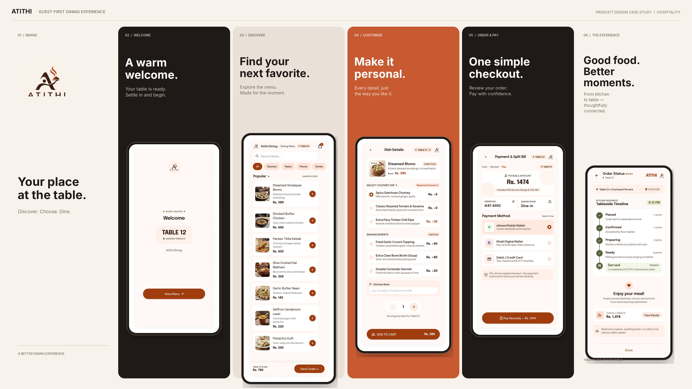
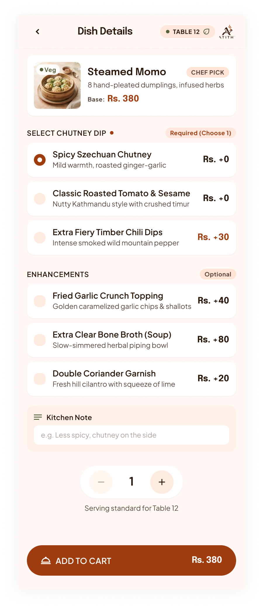
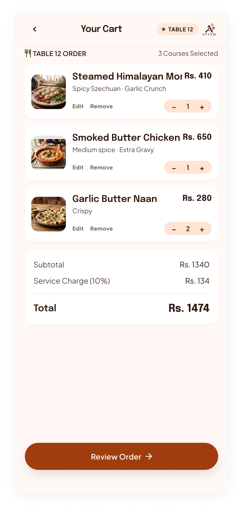
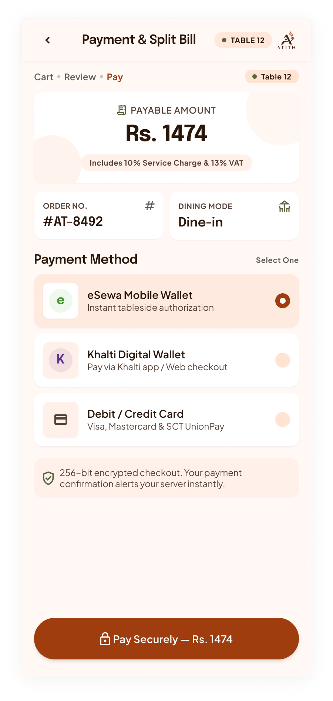

# ATITHI — Guest-First Restaurant Ordering & Dining Experience

<p align="center">
  
</p>

<p align="center">
  <strong>Your place at the table.</strong><br/>
  A guest-first digital restaurant ordering interface designed to make dining simpler, clearer, and more transparent.
</p>

<p align="center">
  <a href="https://www.figma.com/design/ExJ4iCur5gL5o8fWuVqOIX/Atithi?node-id=0-1&t=Cy7qbnhQN4zsb8PA-1"><strong>View Figma Design & Prototype</strong></a> •
  <a href="design/design-decisions.md"><strong>Design Decisions</strong></a> •
  <a href="prototype/figma-link.md"><strong>Prototype Notes</strong></a>
</p>

---

## Project Overview

**ATITHI** (meaning *guest*) is a guest-first digital restaurant ordering and dining platform designed around putting the diner at the centre of the experience.

A guest scans a QR code placed at their table, explores the digital menu, customizes dishes, reviews their cart, completes payment, and tracks order progress—reducing ordering delays and communication gaps between diners, service staff, and kitchen operations.

**Core Guest Flow:**

`Discover → Choose → Customize → Order → Pay → Track`

---

## Problem Statement

Traditional dine-in ordering often creates avoidable friction:

- **Waiting Friction:** Guests must wait for staff availability before browsing menus or placing orders.
- **Limited Dish Clarity:** Physical menus often lack sufficient ingredient, dietary, or customization details.
- **Customization Gaps:** Special requests can get lost or miscommunicated between guests, servers, and the kitchen.
- **Payment Uncertainty:** Diners may not receive immediate confirmation that an order or payment went through.
- **Low Order Visibility:** Guests rarely have clear updates on preparation progress after ordering.

ATITHI addresses these pain points through a structured, self-paced digital dining interface.

---

## Project Objectives

1. **Simplify Ordering:** Enable guests to browse and place orders directly from their phone via table QR access.
2. **Improve Menu Discovery:** Present categories, pricing, and item details cleanly for fast scanning.
3. **Enable Customization:** Allow diners to tailor dishes before adding them to their cart.
4. **Streamline Checkout:** Provide a clear review and payment confirmation flow.
5. **Increase Transparency:** Surface real-time-style order confirmation and preparation tracking states.
6. **Support Operations (Planned):** Lay the groundwork to connect guest ordering with staff and kitchen workflows in future phases.

---

## Target Users

| User Group | Primary Needs | Current Scope |
| :--- | :--- | :--- |
| **Restaurant Guests** *(Primary)* | Fast menu access, clear dish details, easy customization, confident checkout, and order visibility. | **Designed in Phase 1** |
| **Restaurant Staff** *(Secondary)* | Clear incoming orders, accurate customization notes, and minimal operational overhead. | Planned (Future Phase) |
| **Kitchen Staff** *(Secondary)* | Organized tickets, customization clarity, and straightforward status updates. | Planned (Future Phase) |

---

## Core User Journey

The guest experience is structured around six clear stages:

| Stage | Goal | Guest Action |
| :--- | :--- | :--- |
| **1. Discover** | Enter the experience | Scan the table QR code and land on the restaurant's digital home screen |
| **2. Choose** | Explore dishes | Browse food categories and open menu items |
| **3. Customize** | Personalize order | Adjust preferences and review item details |
| **4. Order** | Confirm selection | Review cart items, quantities, and pricing |
| **5. Pay** | Complete checkout | Proceed through payment and order confirmation |
| **6. Track** | Stay informed | Monitor order confirmation and preparation status |

---

## Design Approach

ATITHI balances warmth with clarity—approachable for everyday guests while remaining structured enough for real hospitality environments.

| Dimension | Attributes |
| :--- | :--- |
| **Brand Personality** | Warm · Modern · Intuitive |
| **Product Experience** | Simple · Clear · Intuitive |

### Design Principles

- **Guest-Centric Flow:** Prioritize diner clarity at every screen transition.
- **Clarity Over Clutter:** Keep choices, pricing, and CTAs scannable without delivery-app noise or POS complexity.
- **Consistent Structure:** Maintain predictable navigation and visual hierarchy across the flow.
- **Accessible for All Diners:** Design interactions that feel intuitive regardless of technical familiarity.

---

## Interface Showcase

*Screens below are exported directly from the Phase 1 Figma design.*

### 1. Home & Menu Discovery

<p align="center">
  
  
</p>

### 2. Food Details & Customization

<p align="center">
  
</p>

### 3. Cart & Checkout

<p align="center">
  
  
</p>

### 4. Order Confirmation & Tracking

<p align="center">
  
</p>

---

## Project Roadmap

| Phase | Focus Area | Status |
| :--- | :--- | :--- |
| **Phase 1** | Product Concept, Core UX Flow & Guest UI/UX Prototype (Figma) | **Completed / Active** |
| **Phase 2** | Brand Identity Refinement & Visual System | In Progress |
| **Phase 3** | Frontend Web/Mobile Application Development | Planned |
| **Phase 4** | Backend, Database & Staff/Kitchen Order Dashboard | Planned |
| **Phase 5** | Payment Gateway Integration, Testing & Deployment | Planned |

---

## Tools & Repository Structure

- **UI/UX Design & Prototyping:** Figma
- **Documentation & Version Control:** Git & GitHub

```text
ATITHI/
├── README.md
├── assets/
│   ├── logo/
│   ├── previews/
│   └── screenshots/
├── design/
│   └── design-decisions.md
└── prototype/
    └── figma-link.md
